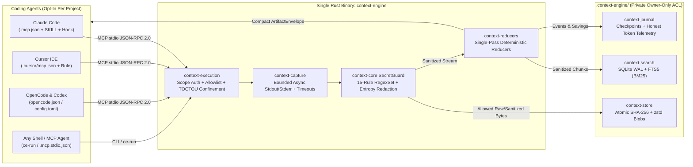

# Rust Context Engine (`context-engine`)

A self-hosted Rust CLI and workspace-scoped stdio MCP server. `context-engine` captures build, test, Git, search, and log output, returns compact summaries, and indexes secret-redacted text in SQLite FTS5. It can recover stored byte ranges or show line pages without rerunning the original command.

The native binary uses local stdio. Optional agent hooks may need additional runtimes, and commands launched through the capture tool run with local process permissions. Byte-exact recovery applies to retained, complete streams whose original bytes were preserved. Capture limits, secret redaction, quarantine, and pruning can affect what is recoverable.

## Install and start

The portable release workflow targets Linux x86-64 GNU. PR CI runs the archive checks on Ubuntu 22.04 and the release binary checks on Windows x64. An extracted local Windows x64 GNU candidate ZIP passed startup, stdio MCP, and byte recovery on Windows build 26300. Published clean-install verification is pending for both platforms. macOS and ARM are outside the verified platform scope.

For a source build, use current stable Rust with Cargo and a native C toolchain. On Windows x64, use the MSVC toolchain and Visual Studio C++ Build Tools. Build from the repository root.

```sh
cargo build --locked --release -p context-cli
```

The default build outputs are `target/release/context-engine` on Linux and `target\release\context-engine.exe` on Windows. Run the binary with `--version` as a read-only first check. For version `0.1.0`, the expected output is `context-engine 0.1.0`.

When a Linux release is published, download the `.tar.gz` archive and its `SHA256SUMS` from the same release and verify the archive before extracting it. The runbook has the exact commands and a fixture recovery check. [GitHub Releases](https://github.com/vinothhacks/rust-context-engine/releases) · [Operations runbook](docs/operations.md#1-installation-and-first-use)

## Connect an MCP client over stdio

Use an absolute binary path and an absolute path to a disposable workspace for the first connection. This example uses a client’s project configuration with `mcpServers`.

```json
{
  "mcpServers": {
    "context-engine": {
      "command": "/home/me/tools/context-engine",
      "args": ["mcp", "--workspace", "/home/me/projects/test-workspace"]
    }
  }
}
```

For Codex, use the project’s `.codex/config.toml`.

```toml
[mcp_servers.context_engine]
command = 'C:\tools\context-engine.exe'
args = ['mcp', '--workspace', 'C:\projects\test-workspace']
```

Confirm the MCP client lists `context_run`, `context_index`, `context_search`, `context_get`, `context_resume`, `context_stats`, and `context_doctor`. Starting the server opens workspace-local state in `.context-engine/`.

---

## Architecture Overview



### Workspace Crate Responsibilities

| Crate | Responsibility |
| :--- | :--- |
| `context-core` | `ArtifactEnvelope` v1 contract, server-bound `WorkspaceScopeId` (`ws_<32-hex>`), opaque `ArtifactId` (`a_<64-hex>`), `ReductionBudget`, `TransformationLedger`, and `SecretGuard`. |
| `context-execution` | Direct `argv` execution gate (no shell by default), 18-tool dev allowlist, destructive flag denylist, env var scrubbing, symlink/NTFS junction escape rejection, and post-open TOCTOU file checks. |
| `context-capture` | Concurrent bounded `stdout`/`stderr` streaming (`16 MiB` default per stream), deadline timeouts, `kill_on_drop(true)`, and cooperative MCP cancellation. |
| `context-store` | Crash-safe atomic `zstd` blob persistence (`blobs/<2-hex>/<sha256>.zst`), scoped manifests, owner-only Windows `icacls` DACLs / Unix `0700` permissions, and TTL + LRU byte-quota pruning. |
| `context-reducers` | Deterministic single-pass reducers: `strip_ansi@1`, `cargo_test@1`, `pytest_jest@1`, `compiler_diag@1`, `git_reducer@1`, `structured_json@1`, `log_dedup@1`, `search_hits@1`, and `unknown_safe@1`. |
| `context-search` | Per-workspace SQLite WAL + FTS5 (`porter unicode61`, `bm25()`) over sanitized line-addressed chunks with defense-in-depth post-redaction assertions. |
| `context-journal` | Append-only session event ledger, deterministic `context_resume` checkpoints (`ResumePack`), and honest net token/byte accounting (`exposed = view + retrieved`). |
| `context-mcp` | Workspace-scoped MCP JSON-RPC 2.0 server supporting both newline-delimited stdio and auto-detected `Content-Length` framing across all 7 `context_*` tools. |
| `context-cli` | Unified `context-engine` binary (`run`, `index`, `search`, `get`, `resume`, `stats`, `prune`, `doctor`, `mcp`, `setup`) with all 23 adapter assets embedded at compile time. |

---

## Opt-in agent integrations

`context-engine setup` defaults to `--dry-run`. Preview the rendered files before opting in with `--write-project`. The examples use a binary kept at `C:\tools\context-engine.exe` and a project at `D:\path\to\project`.

```powershell
$engine = 'C:\tools\context-engine.exe'
```

### 1. Claude Code

```powershell
# Preview rendered .mcp.json, SKILL.md, and optional PostToolUse hook (writes 0 files):
& $engine setup --client claude-code --workspace "D:\path\to\project" --binary $engine --dry-run

# Opt in for a single project workspace:
& $engine setup --client claude-code --workspace "D:\path\to\project" --binary $engine --write-project
```

- Installs project-local `.mcp.json`, `.claude/skills/context-engine/SKILL.md`, `.claude/context-engine.CLAUDE.snippet.md`, and optional Node 24 `.claude/hooks/post-tool-reduce.mjs`.

### 2. Cursor IDE

```powershell
# Preview first:
& $engine setup --client cursor --workspace "D:\path\to\project" --binary $engine --dry-run

# Opt in for a single project workspace:
& $engine setup --client cursor --workspace "D:\path\to\project" --binary $engine --write-project
```

- Merges `"context-engine"` into `<project>/.cursor/mcp.json` and writes `<project>/.cursor/rules/context-engine.mdc` (plus optional `afterShellExecution` capture hooks).

### 3. OpenCode

```powershell
& $engine setup --client opencode --workspace "D:\path\to\project" --binary $engine --write-project
```

- Merges MCP registration, tool permissions, and `.opencode/plugin/context-engine-plugin.mjs` into `<project>/opencode.json`.

### 4. OpenAI Codex CLI

```powershell
& $engine setup --client codex --workspace "D:\path\to\project" --binary $engine --write-project
```

- Merges `[mcp_servers.context_engine]` into `<project>/.codex/config.toml` and emits `.codex/context-engine.AGENTS.snippet.md`.

### 5. Windsurf, Cline, Roo Code, Continue & Zed (`generic-mcp`)

```powershell
& $engine setup --client windsurf --workspace "D:\path\to\project" --binary $engine --write-project
```

- Renders `<project>/.mcp.stdio.json` (also compatible with `--client cline`, `--client continue`, `--client roo-code`, `--client zed`, or `--client generic`) alongside `ce-run` CLI wrappers.

### 6. Any Shell Coding Agent (`ce-run` — Zero MCP Required)

Agents without MCP support (Aider, SWE-agent, custom CLI loops, CI scripts) can invoke `context-engine` directly or via the zero-interpolation `ce-run` wrappers generated under `<project>/.context-engine/bin/`:

```powershell
# Windows PowerShell (preserves exact child exit code)
.\.context-engine\bin\ce-run.ps1 cargo test --locked --workspace
.\.context-engine\bin\ce-run.ps1 git diff

# Search and read stored lines without rerunning cargo test.
& $engine search "assertion failed" --workspace .
& $engine get 'ARTIFACT_ID' --workspace . --stream stdout --lines 1:80
```

```sh
# POSIX shell wrapper
./.context-engine/bin/ce-run.sh pytest -q
```

---

## Coexistence with `headroom`, `caveman`, and Global Tooling

1. **Project-Local Only:** Global configurations (`~/.claude/settings.json`, `~/.cursor/mcp.json`, `user-headroom` MCP, global `caveman` skills/hooks) are never read for mutation or modified.
2. **Never Touches User Prompts:** Unlike prompt-rewriting hooks, `context-engine` never intercepts `UserPromptSubmit` or alters user instructions.
3. **Mutual Marker Detection (Zero Double-Compression):**
   - Outputs reduced by `context-engine` carry `view.transformations` ledgers and `[context-engine:v1 artifact=... transforms=...]` banners.
   - All opt-in `context-engine` hooks and plugins explicitly skip payloads already carrying `[headroom`, `"headroom_ref"`, `"smart_crusher"`, `"kompress"`, `CCR-`, `[caveman`, `<!-- caveman`, or `caveman-compress` markers, and never wrap direct `headroom` or `caveman` CLI invocations.
4. **Instant Opt-Out:** Set `CONTEXT_ENGINE_DISABLE_HOOK=1` in the environment to bypass any installed post-tool hook immediately with zero config edits.

---

## Documentation Index

- **[API Contract (`docs/api-contract.md`)](docs/api-contract.md):** Complete v1 `ArtifactEnvelope` schema, CLI flags & exit codes, MCP stdio framing modes (`NewlineDelimited` & `Content-Length`), error codes, and JSON request/response examples for all 7 MCP tools.
- **[Security & Retention (`docs/security-and-retention.md`)](docs/security-and-retention.md):** Confinement boundaries, `SecretGuard` 15-rule table, `ExecutionGate` allowlist/denylist, SQLite WAL + FTS5 isolation, retention/quota pruning, CycloneDX 1.5 SBOM license audit, and PE32+ binary hardening verification.
- **[Operations Runbook (`docs/operations.md`)](docs/operations.md):** Portable deployment, `doctor` diagnostics, `prune`/backup/upgrade procedures, rollback switches, and REA MCP (`npx rea-agents@6.10.1 doctor`) troubleshooting.
- **[Threat Model (`docs/threat-model.md`)](docs/threat-model.md) & [ADRs (`docs/adrs/`)](docs/adrs/):** STRIDE analysis and architectural decision records (`0001`–`0004`).
- **[Provenance & Licenses (`research/provenance-and-licenses.md`)](research/provenance-and-licenses.md) & [`NOTICE`](NOTICE):** Upstream Apache-2.0 / MIT attributions and clean-room `Elastic-2.0` exclusion record.
- **Historical V1 evaluations** document the fixtures and measurements from the original development run. [Benchmark report](evals/reports/v1-benchmark-report.md)

## License

Apache-2.0 or MIT, at your option. [Apache-2.0](LICENSE-APACHE) · [MIT](LICENSE-MIT) · [NOTICE](NOTICE)
