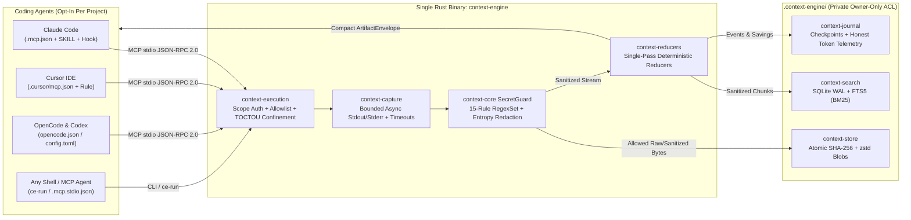

# Rust Context Engine (`context-engine`)

A self-hosted, single-binary **Rust context-optimization engine** (`CLI` + workspace-scoped `stdio` MCP server) that captures noisy build, test, compiler, Git, search, JSON, and log outputs once, returns deterministic compact summaries (`ArtifactEnvelope` v1), indexes secret-redacted chunks into per-workspace SQLite WAL + FTS5, and serves byte-exact or line-paginated original slices on demand without re-running commands.

- **100% Local & Zero Network Egress:** Pure native Rust (`#![forbid(unsafe_code)]` across all workspace crates). No LLM summarizers, no cloud proxies, no vector APIs, and zero runtime dependencies on Node.js or Python.
- **Zero Interference with Global Setups:** Never modifies `~/.cursor`, `~/.claude`, `~/.codex`, `~/.config/opencode`, or `%APPDATA%`. Coexists cleanly alongside `headroom` and `caveman` via explicit single-pass transformation ledgers (`view.transformations`).
- **Byte-Exact Recoverability:** Separate `stdout` and `stderr` content-addressed `zstd` blobs verified by SHA-256, recoverable by 1-indexed `--lines start:end` or binary-safe `--bytes start:end`.

---

## Architecture Overview



### Workspace Crate Responsibilities

| Crate | Responsibility |
| :--- | :--- |
| `context-core` | `ArtifactEnvelope` v1 contract, server-bound `WorkspaceScopeId` (`ws_<32-hex>`), opaque `ArtifactId` (`a_<64-hex>`), `ReductionBudget`, `TransformationLedger`, and `SecretGuard`. |
| `context-execution` | Direct `argv` execution gate (no shell by default), 18-tool dev allowlist, destructive flag denylist, env var scrubbing, symlink/NTFS junction escape rejection, and post-open TOCTOU file checks. |
| `context-capture` | Concurrent bounded `stdout`/`stderr` streaming (`16 MiB` default per stream), deadline timeouts, `kill_on_drop(true)`, and cooperative MCP cancellation. |
| `context-store` | Crash-safe atomic `zstd` blob persistence (`blobs/<2-hex>/<sha256>.zst`), scoped manifests, owner-only Windows `icacls` DACLs / Unix `0700` permissions, and TTL + LRU byte-quota pruning. |
| `context-reducers` | Deterministic single-pass reducers: `strip_ansi@1`, `cargo_test@1`, `pytest_jest@1`, `compiler_diag@1`, `git_reducer@1`, `structured_json@1` (differentially verified on 1,180 recorded + 2,748 fuzz cases with `0` mismatches and `6.94x` speedup), `log_dedup@1`, `search_hits@1`, and `unknown_safe@1`. |
| `context-search` | Per-workspace SQLite WAL + FTS5 (`porter unicode61`, `bm25()`) over sanitized line-addressed chunks with defense-in-depth post-redaction assertions. |
| `context-journal` | Append-only session event ledger, deterministic `context_resume` checkpoints (`ResumePack`), and honest net token/byte accounting (`exposed = view + retrieved`). |
| `context-mcp` | Workspace-scoped MCP JSON-RPC 2.0 server supporting both newline-delimited stdio and auto-detected `Content-Length` framing across all 7 `context_*` tools. |
| `context-cli` | Unified `context-engine` binary (`run`, `index`, `search`, `get`, `resume`, `stats`, `prune`, `doctor`, `mcp`, `setup`) with all 23 adapter assets embedded at compile time. |

---

## Measured V1 Benchmark Results & Guarantees

Verified across `86/86` workspace unit, golden, property, E2E stdio MCP, and adversarial security tests plus `23` evaluation fixtures and `20` paired end-to-end debugging tasks ([`evals/reports/v1-benchmark-metrics.json`](evals/reports/v1-benchmark-metrics.json) — **`7/7` V1 acceptance gates passed**):

| Dimension | V1 Acceptance Bar | Measured V1 Result |
| :--- | :--- | :--- |
| **Exact Byte Recovery** | `100%` SHA-256 match on authorized fixtures | **`100.0%` (`22 / 22`)** byte-for-byte SHA-256 verified across UTF-8, CRLF, ANSI, and binary streams |
| **Failure Evidence Retention** | `100%` of distinct failure IDs & exit codes | **`100.0%` (`24 / 24` failure IDs, `13 / 13` exit codes)** preserved in compact views |
| **Noisy Output Reduction** | `>= 40.0%` median byte reduction | **`77.69%` median** (`74.49%` across all 23 fixtures; up to **`99.95%`** on 5,000-line `cargo test`) |
| **Paired Net Token Savings** | `>= 25.0%` median net reduction (incl. retrieval) | **`58.91%` median** / **`93.84%` aggregate** (`145,528` -> `8,964` tokens across `20 / 20` tasks incl. `16` retrievals) |
| **Task Effectiveness** | Non-inferior vs uncached baseline (`20 / 20`) | **`20 / 20` (`100%`)** engine task completions vs `20 / 20` baseline (`0` regressions) |
| **Latency & Footprint** | Responsive local `stdio` MCP execution | **`5.34 ms` p50** (`36.04 ms` p95) in-engine MCP tool latency; `20.93 MiB` peak working set |
| **Zero Egress & Secret Isolation** | `0` cross-scope leaks & `0` network sockets | **`0` cross-workspace leaks**, **`0` outbound network sockets**, `0` unredacted secrets in views/FTS5/manifests |
| **Hardened Binary & Supply Chain** | Stripped + CFG/ASLR/DEP/CET + permissive deps | PE32+ `0xc160` (`HIGH_ENTROPY_VA`, `DYNAMIC_BASE`, `NX_COMPAT`, `GUARD_CF`) + `CET_COMPAT`; **`162 / 162` permissive crates** (`0` GPL/AGPL/Elastic-2.0/BUSL-1.1) |

---

## Quick Start (Build & Portable `dist/` Bundle)

Build the hardened release binary, CycloneDX 1.5 SBOM, portable integration kits, health report, and `SHA256SUMS.txt` into `./dist/`:

```powershell
powershell -NoProfile -ExecutionPolicy Bypass -File .\scripts\package-dist.ps1
```

Verify workspace health at any time:

```powershell
.\dist\context-engine.exe doctor --workspace "D:\path\to\your-project"
```

---

## 1-Command Opt-In Agent Integrations

`context-engine setup` **defaults safely to `--dry-run`**. It never touches `~/.cursor`, `~/.claude`, `~/.codex`, or `~/.config/opencode`—in fact, passing any global user config directory fails closed with `SCOPE_VIOLATION` (`exit 77`). When `--write-project` is explicitly passed on a target repo, existing unrelated `mcpServers` entries are preserved via lossless JSON/TOML merging.

### 1. Claude Code

```powershell
# Preview rendered .mcp.json, SKILL.md, and optional PostToolUse hook (writes 0 files):
.\dist\context-engine.exe setup --client claude-code --workspace "D:\path\to\project" --binary "D:\research 1\mcp\token reducer\dist\context-engine.exe" --dry-run

# Opt in for a single project workspace:
.\dist\context-engine.exe setup --client claude-code --workspace "D:\path\to\project" --binary "D:\research 1\mcp\token reducer\dist\context-engine.exe" --write-project
```

- Installs project-local `.mcp.json`, `.claude/skills/context-engine/SKILL.md`, `.claude/context-engine.CLAUDE.snippet.md`, and optional Node 24 `.claude/hooks/post-tool-reduce.mjs`.

### 2. Cursor IDE

```powershell
# Preview first:
.\dist\context-engine.exe setup --client cursor --workspace "D:\path\to\project" --binary "D:\research 1\mcp\token reducer\dist\context-engine.exe" --dry-run

# Opt in for a single project workspace:
.\dist\context-engine.exe setup --client cursor --workspace "D:\path\to\project" --binary "D:\research 1\mcp\token reducer\dist\context-engine.exe" --write-project
```

- Merges `"context-engine"` into `<project>/.cursor/mcp.json` and writes `<project>/.cursor/rules/context-engine.mdc` (plus optional `afterShellExecution` capture hooks).

### 3. OpenCode

```powershell
.\dist\context-engine.exe setup --client opencode --workspace "D:\path\to\project" --binary "D:\research 1\mcp\token reducer\dist\context-engine.exe" --write-project
```

- Merges MCP registration, tool permissions, and `.opencode/plugin/context-engine-plugin.mjs` into `<project>/opencode.json`.

### 4. OpenAI Codex CLI

```powershell
.\dist\context-engine.exe setup --client codex --workspace "D:\path\to\project" --binary "D:\research 1\mcp\token reducer\dist\context-engine.exe" --write-project
```

- Merges `[mcp_servers.context_engine]` into `<project>/.codex/config.toml` and emits `.codex/context-engine.AGENTS.snippet.md`.

### 5. Windsurf, Cline, Roo Code, Continue & Zed (`generic-mcp`)

```powershell
.\dist\context-engine.exe setup --client windsurf --workspace "D:\path\to\project" --binary "D:\research 1\mcp\token reducer\dist\context-engine.exe" --write-project
```

- Renders `<project>/.mcp.stdio.json` (also compatible with `--client cline`, `--client continue`, `--client roo-code`, `--client zed`, or `--client generic`) alongside `ce-run` CLI wrappers.

### 6. Any Shell Coding Agent (`ce-run` — Zero MCP Required)

Agents without MCP support (Aider, SWE-agent, custom CLI loops, CI scripts) can invoke `context-engine` directly or via the zero-interpolation `ce-run` wrappers generated under `<project>/.context-engine/bin/`:

```powershell
# Windows PowerShell (preserves exact child exit code)
.\.context-engine\bin\ce-run.ps1 cargo test --workspace
.\.context-engine\bin\ce-run.ps1 git diff

# Search FTS5 and recover exact lines without re-running cargo test:
.\dist\context-engine.exe search "assertion failed" --workspace .
.\dist\context-engine.exe get <artifact_id> --workspace . --stream stdout --lines 1:80
```

```sh
# Linux / macOS / WSL POSIX sh
./.context-engine/bin/ce-run.sh pytest -q
```

---

## Coexistence with `headroom`, `caveman`, and Global Tooling

1. **Project-Local Only:** Global configurations (`~/.claude/settings.json`, `~/.cursor/mcp.json`, `user-headroom` MCP, global `caveman` skills/hooks) are never read for mutation or modified.
2. **Never Touches User Prompts:** Unlike prompt-rewriting hooks, `context-engine` never intercepts `UserPromptSubmit` or alters user instructions.
3. **Mutual Marker Detection (Zero Double-Compression):**
   - Outputs reduced by `context-engine` carry `view.transformations` ledgers and `[context-engine:v1 artifact=... transforms=...]` banners.
   - All opt-in `context-engine` hooks and plugins explicitly skip payloads already carrying `[headroom`, `"headroom_ref"`, `"smart_crusher"`, `"kompress"`, `CCR-`, `[caveman`, `<!-- caveman`, or `caveman-compress` markers, and never wrap direct `headroom` or `caveman` CLI invocations.
4. **Instant Opt-Out:** Set `CONTEXT_ENGINE_DISABLE_HOOK=1` in the environment to bypass any installed post-tool hook immediately with zero config edits.

---

## Documentation Index

- **[API Contract (`docs/api-contract.md`)](docs/api-contract.md):** Complete v1 `ArtifactEnvelope` schema, CLI flags & exit codes, MCP stdio framing modes (`NewlineDelimited` & `Content-Length`), error codes, and JSON request/response examples for all 7 MCP tools.
- **[Security & Retention (`docs/security-and-retention.md`)](docs/security-and-retention.md):** Confinement boundaries, `SecretGuard` 15-rule table, `ExecutionGate` allowlist/denylist, SQLite WAL + FTS5 isolation, retention/quota pruning, CycloneDX 1.5 SBOM license audit, and PE32+ binary hardening verification.
- **[Operations Runbook (`docs/operations.md`)](docs/operations.md):** Portable deployment, `doctor` diagnostics, `prune`/backup/upgrade procedures, rollback switches, and REA MCP (`npx rea-agents@6.10.1 doctor`) troubleshooting.
- **[Threat Model (`docs/threat-model.md`)](docs/threat-model.md) & [ADRs (`docs/adrs/`)](docs/adrs/):** STRIDE analysis and architectural decision records (`0001`–`0004`).
- **[Provenance & Licenses (`research/provenance-and-licenses.md`)](research/provenance-and-licenses.md) & [`NOTICE`](NOTICE):** Upstream Apache-2.0 / MIT attributions and clean-room `Elastic-2.0` exclusion record.
